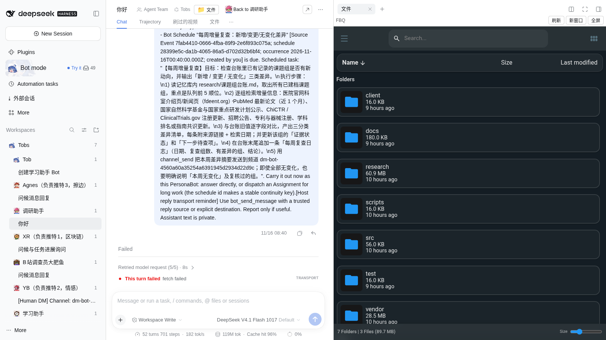
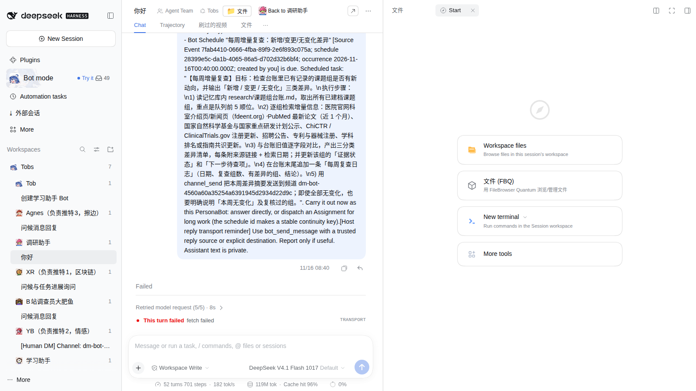
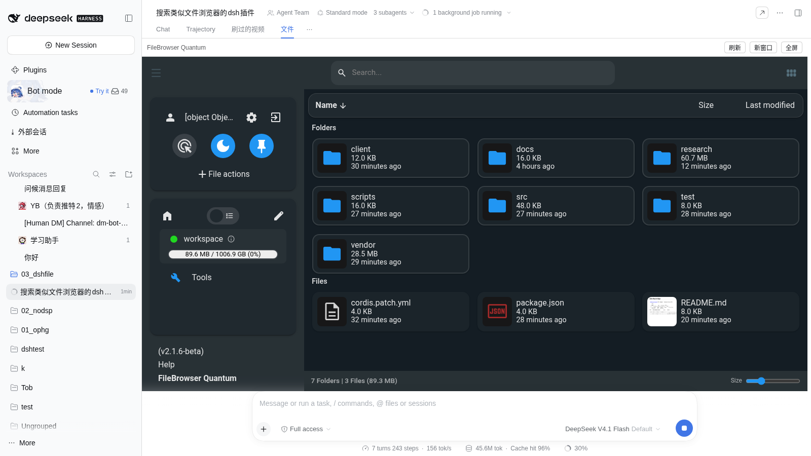

# dsh-quantum-files

[](https://github.com/lovivi/dsh-quantum-files/actions/workflows/ci.yml)

在 DSH 里用 FileBrowser Quantum 管文件。两行命令装好：

```sh
dsh plugin --profile web add github:lovivi/dsh-quantum-files
~/.dsh/start-web.sh restart
```

装完刷新浏览器，**进任意会话，点标题右侧的「📁 文件」**。

其他装法：

```sh
dsh plugin --profile web add dsh-quantum-files      # npm（发布后可用）
dsh plugin --profile web add link:/path/to/repo     # 本地开发
```

## 先看效果

右侧栏（工具条上的「全屏」可以铺满视口）：



右侧栏 `+` → 指南里的入口，点开就是同一个 FBQ：



对话区全宽形态，适合当主文件管理器：



## 让 agent 帮你装

把下面整段复制给任意一个 DSH 会话，它会自己装好并验证：

```
请帮我安装并启用 DSH 插件 dsh-quantum-files：运行 dsh plugin --profile web add github:lovivi/dsh-quantum-files，然后执行 ~/.dsh/start-web.sh restart；起来后确认 GET /-/fbq/ 返回 200、右侧栏能看到「文件」入口，并把入口位置告诉我。注意：首次启动会按内置 sha256 下载约 29 MB 的 FBQ 二进制，需要联网；安装会改动 profile，属于会写盘的操作。
```

## 装好后你会看到

三个入口，同一个 FBQ，同一份文件：

| 入口 | 怎么到 | 长什么样 |
|---|---|---|
| 会话头按钮 | 会话标题右侧那一排点「📁 文件」 | 右侧栏弹出，里面是 FBQ 界面 |
| 右侧栏 tab | 右侧栏点 `+` → 指南「文件 (FBQ)」 | 窄栏，工具条简化为 `FBQ｜刷新｜新窗口｜全屏` |
| 对话区 tab | 顶部 `Chat｜Trajectory｜…｜文件` | 全宽，适合当主文件管理器 |

外加一个独立端口 `https://<host>:3090/`，手机或别的电脑直接用，口令在配置文件里。

## 它是怎么工作的

FBQ 只监听 Unix socket，不占任何端口。插件开两个同源前门反代到它：

```
DSH :3080  /-/fbq/*  → [校验 DSH 会话] ─┐
                                        ├─→ FBQ（unix socket, baseURL=/-/fbq）
独立 :3090  /-/fbq/*  → [校验口令]    ──┘      文件管理 / 分享 / 配额 / WebDAV
```

好处：FBQ 的 `proxy` 认证会盲信身份头，物理上只能通过两个前门访问，就无法伪造 header 提权。

## 配置（可选，约 2 分钟）

不改也能用。要改就编辑 `~/.dsh/fbq/config.json`：

```json
{
  "fbq": { "workspaceRoot": "/home/me/work/my-project" },
  "auth": { "mode": "proxy" },
  "direct": { "enabled": true, "host": "0.0.0.0", "port": 3090, "username": "dsh" }
}
```

改完 `~/.dsh/start-web.sh restart`。

常用的五个键：

| 键 | 默认 | 什么时候改 |
|---|---|---|
| `fbq.workspaceRoot` | 启动目录 | 想让 FBQ 打开别的目录 |
| `auth.mode` | `proxy` | 多人各自要账号 → 改成 `password`（用 FBQ 自己的登录页） |
| `direct.enabled` | `false` | 手机/别的电脑要访问 → `true` |
| `direct.password` | 自动生成 | 首次启动会生成随机口令并写回此文件，日志里也打一行 |
| `fbq.binary` | 自动下载 | 要用手工放好的二进制 → 填绝对路径 |

完整配置项在 [docs/CONFIG.md](docs/CONFIG.md)。

## 出问题了

| 症状 | 原因 | 修法 |
|---|---|---|
| 看不到「📁 文件」按钮 | 页面还是旧 bundle | 硬刷新（Ctrl+Shift+R） |
| 右侧栏显示「这类内容还没有可用的查看方式」 | 之前版本的 bug（`keyed` 槽位传错参数） | 升级到 ≥0.1.0 并硬刷新 |
| 页面里 503、提示 fbq-not-ready | FBQ 还在启动或正在重启 | 等 10 秒刷新；仍不行看 `~/.dsh/fbq/data/` 下的进程状态 |
| `dsh plugin add` 报 lockfile 校验失败 | pnpm 12 对旧锁文件更严格 | 用 pnpm 11：`npm i -g pnpm@11.1.3` |
| 装依赖卡住不动 | registry 不通（国内） | `npm_config_registry=https://registry.npmjs.org/ dsh plugin --profile web add dsh-quantum-files` |

FBQ 进程日志在 `~/.dsh/logs/dsh-web.log`；状态端点 `GET /-/fbq/__bridge/status` 会返回 PID、就绪状态和最近日志。

## 安全（发布前必读）

1. FBQ 首次使用会**按内置 sha256 校验后**下载（约 29 MB，写进 `$DSH_HOME/fbq/bin/`）。不想下载就放好二进制并用 `fbq.binary` 指过去。
2. 插件跑在 DSH 宿主进程里，**不受会话文件沙箱（workspace-write）限制**，能读整盘。
3. `proxy` 模式下 FBQ 盲信身份头。**不要**把 `fbq.yaml` 改成让 FBQ 监听 TCP——那等于把管理员权限挂在网上。
4. `auth.mode: password` 是给多人用的；单人自用保持 `proxy` 就好，进 DSH 免登录。
5. 插件不收集遥测，除首次下载二进制外不主动联网。

## 开发

```sh
npm test                                  # 36 条用例，不到 1 秒，不需要 DSH / 不需要真 FBQ
node scripts/build-client.mjs             # 改完 client/index.js 必须重跑（CI 会检查）
node scripts/dev-server.js --port 3091    # 带真 FBQ 的旁路 harness，不碰 DSH
node scripts/verify.js --base http://127.0.0.1:3091   # 对跑起来的端点压端到端用例
node scripts/update-binaries.js v2.1.6-beta           # 升级 FBQ 版本时重建摘要清单
```

测试分三层，都在 `test/` 下：

- `unit.test.js` — 头过滤、身份头伪造防护、CSP 剥离、鉴权门、配置合并
- `client.test.js` — 在假 DOM 里执行 bundle，按**真实槽位契约**校验三个入口的注册
- `integration.test.js` — 假上游 unix socket，跑通两个前门：fail-closed、注入、Range、大 body、PROPFIND、502、只读

## 目录

```
src/       host 平面：config / binaries / supervisor / proxy / gate / direct / index
client/    client 平面：index.js（源码）+ bundle.js（构建产物，必须提交）
scripts/   build-client / dev-server / verify / update-binaries
test/      unit / client / integration 三层
docs/      CONFIG.md 完整配置 · PLAN.md 设计与测试计划 · PUBLISHING.md 发布清单
```

## 限制

1. 分享链接的域名由 FBQ 的 `http.externalUrl` 决定，只能填一个；两个入口域名不同时，另一边的分享链接会指向配置的那个。
2. 右栏很窄，用工具条上的「全屏」铺满视口更舒服。
3. 只用 Linux 实测过；macOS / Windows 的分支和二进制清单已备好但未验证。
4. FBQ 版本固定在 `src/binaries.js`，升级要走 `scripts/update-binaries.js` 再冒烟。

## License

MIT。运行时下载的 FileBrowser Quantum 是 Apache-2.0，遵循它自己的许可。
